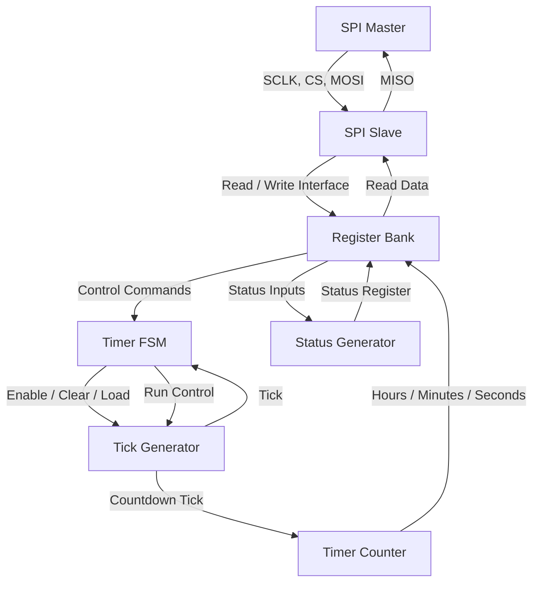
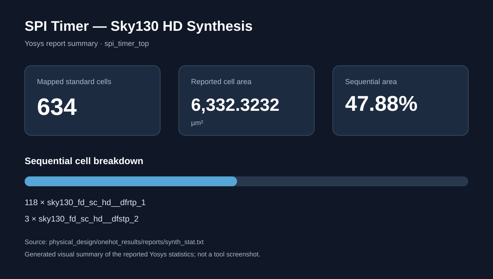
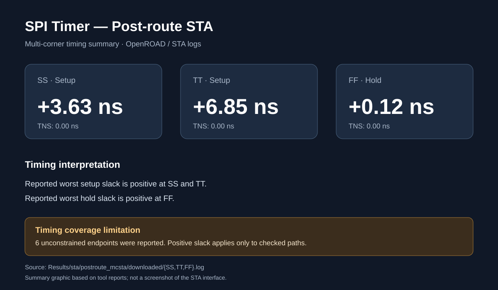
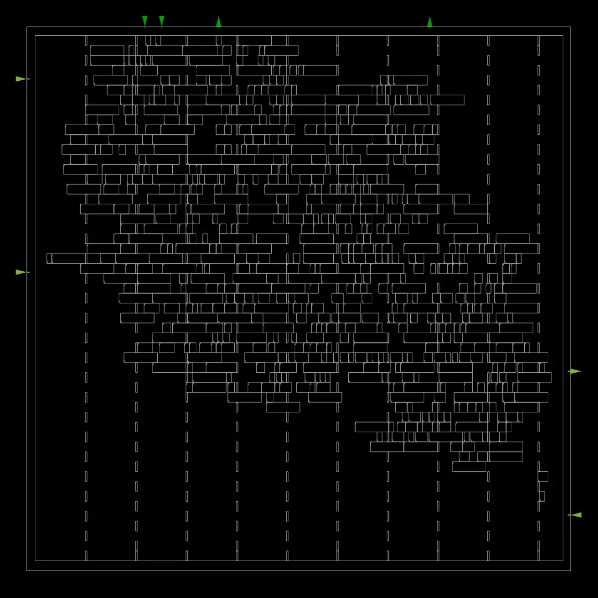
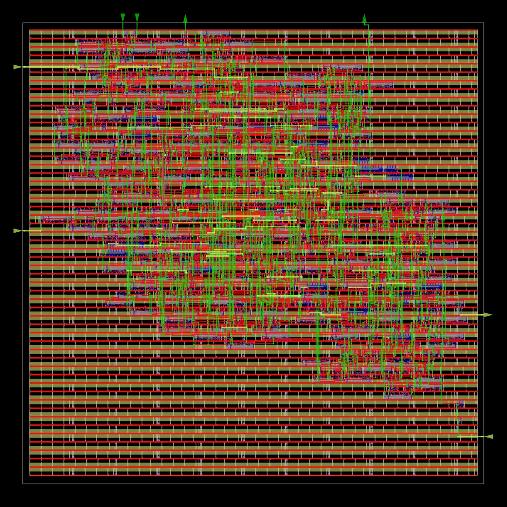
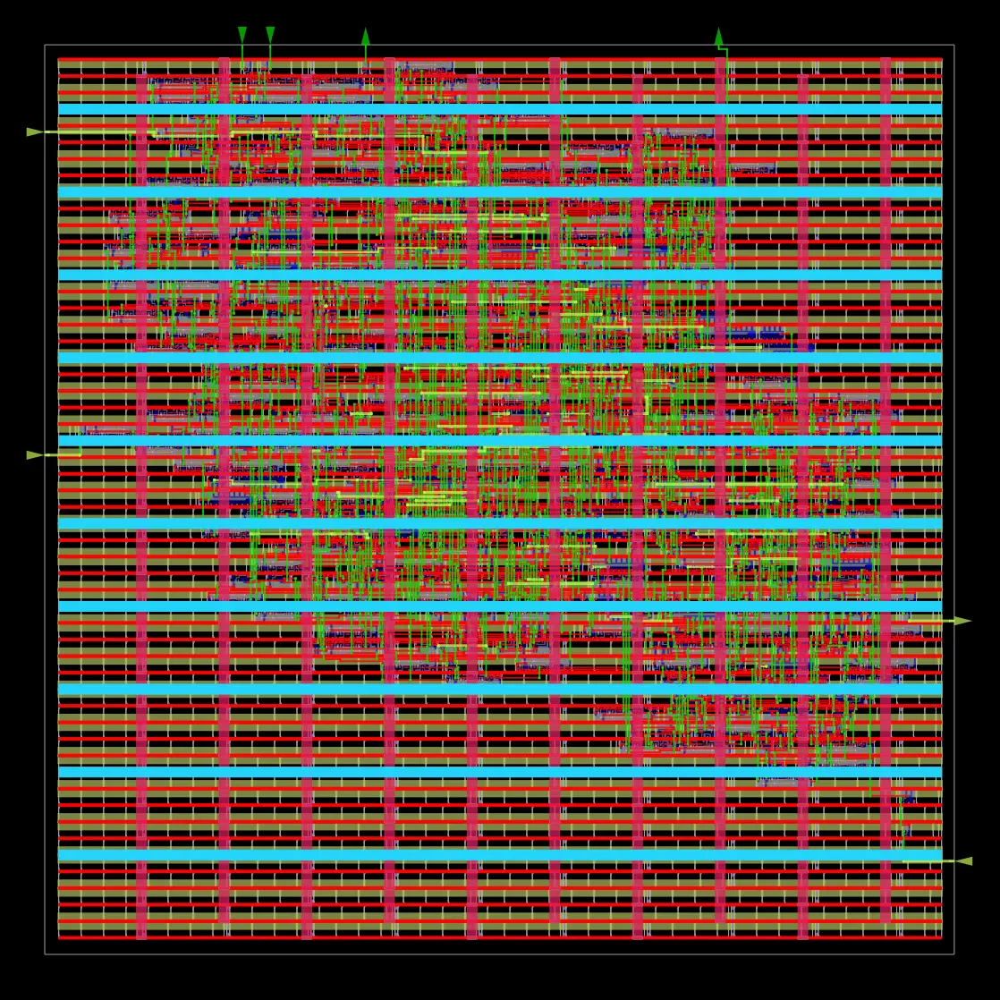

# SPI-Controlled Digital Timer Using Verilog HDL

A programmable countdown timer designed using Verilog HDL with an SPI Mode-0 slave interface. The timer supports configurable hours, minutes and seconds, along with start, stop, pause, resume and reset operations.

## 1. Features

- SPI Mode 0 communication
- 16-bit, MSB-first SPI frames
- Configurable hours, minutes and seconds
- Start, Stop, Pause, Resume and Reset commands
- Timer configuration and current-time readback through SPI
- Four timer status conditions: IDLE, RUNNING, PAUSED and EXPIRED
- Parameterized countdown tick generator
- Modular Verilog RTL design
- Basic and extended self-checking testbenches
- Simulation logs and waveform files

## 2. Project Architecture

The design is divided into six main functional blocks connected through the top-level module.



### Module Description

| RTL Module | Function |
|---|---|
| `spi_timer_top.v` | Top-level module connecting all functional blocks |
| `spi_slave.v` | Handles SPI serial communication |
| `reg_bank.v` | Stores timer configuration and control registers |
| `timer_fsm.v` | Controls timer operating states |
| `tick_gen.v` | Generates the programmable countdown tick |
| `timer_counter.v` | Maintains countdown values and time rollover |
| `status_gen.v` | Generates timer status information |

### Timer Operating States

- **IDLE:** Timer is waiting for a start command.
- **RUN:** Timer is counting down.
- **PAUSE:** Countdown is temporarily stopped.
- **EXPIRED:** Countdown has reached zero.

## 3. SPI Register Map

The timer is controlled through the following register addresses.

| Address | Register | Access |
|---|---|---|
| `0x00` | Control | Write |
| `0x01` | Status | Read |
| `0x02` | Seconds Load | Read/Write |
| `0x03` | Current Seconds | Read |
| `0x04` | Minutes Load | Read/Write |
| `0x05` | Current Minutes | Read |
| `0x06` | Hours Load | Read/Write |
| `0x07` | Current Hours | Read |

### Control Register

Register address: `0x00`

| Bit | Operation |
|---|---|
| Bit 0 | Start |
| Bit 1 | Stop |
| Bit 2 | Pause |
| Bit 3 | Resume |
| Bit 4 | Reset |

### Status Register

Register address: `0x01`

| Bit | Status |
|---|---|
| Bit 0 | Running |
| Bit 1 | Paused |
| Bit 2 | Expired |
| Bit 3 | Idle |

## 4. Project Directory Structure

```text
SPI-Controlled-Digital-Timer/
├── .devcontainer/
│   └── devcontainer.json
│
├── .github/
│   └── workflows/
│       ├── lvs-tool-check.yml
│       ├── sky130-corner-check.yml
│       ├── sky130-liberty-build.yml
│       ├── sky130-openroad.yml
│       └── sky130-platform-inspect.yml
│
├── SPI_Timer/
│   ├── rtl/
│   │   ├── reg_bank.v
│   │   ├── spi_slave.v
│   │   ├── spi_timer_top.v
│   │   ├── status_gen.v
│   │   ├── tick_gen.v
│   │   ├── timer_counter.v
│   │   ├── timer_fsm.v
│   │   └── README_rtl.md
│   ├── testbench/
│   │   ├── tb_spi_timer.v
│   │   ├── tb_spi_timer_extended.v
│   │   └── tb_spi_timer_original.v
│   └── constraints/
│       └── timer.xdc
│
├── Results/
│   ├── LVS/
│   │   ├── 6_lvs.lvsdb
│   │   ├── README.md
│   │   └── spi_timer_top_extracted.cir
│   ├── simulation/
│   │   ├── simulation.log
│   │   └── extended_simulation.log
│   ├── synthesis/
│   │   ├── spi_timer_netlist.v
│   │   ├── yosys_synthesis.log
│   │   └── sky130/
│   │       ├── spi_timer_top_sky130.v
│   │       └── yosys_sky130_mapping.log
│   ├── sta/
│   │   ├── mcsta/
│   │   ├── mcsta_onehot/
│   │   ├── postroute_mcsta/
│   │   │   └── run_corner.tcl
│   │   ├── run_sta.tcl
│   │   ├── run_sta_sync.tcl
│   │   ├── spi_timer.sdc
│   │   └── STA reports and coverage logs
│   └── waveforms/
│       ├── spi_timer.vcd
│       ├── spi_timer_extended.vcd
│       └── spi_timer_extended_waveform.png
│
├── physical_design/
│   ├── onehot_results/
│   │   ├── logs/
│   │   ├── reports/
│   │   └── results/
│   │       ├── 6_final.gds
│   │       ├── 6_final.def
│   │       ├── 6_final.spef
│   │       └── 6_final.v
│   └── openroad/
│       ├── config.mk
│       └── constraint.sdc
│
├── scripts/
│   ├── plot_waveforms.py
│   └── simulate.sh
│
├── .gitignore
└── README.md
```

Generated files not tracked by Git: The Sky130 Liberty libraries are placed in `Results/Liberty/`. Additional downloaded physical-design outputs are stored under `physical_design/output/` and `Results/sta/postroute_mcsta/downloaded/`. These directories are excluded through `.gitignore`. The libraries can be obtained from the corresponding GitHub Actions artifact or regenerated using the project's Liberty workflow.

## 5. Simulation Setup

The project uses Icarus Verilog for RTL simulation.

### Install Icarus Verilog

On Ubuntu or GitHub Codespaces:

```bash
sudo apt-get update
sudo apt-get install -y iverilog
```

Check the installation:

```bash
iverilog -V
vvp -V
```

### Run the Simulation

From the repository root:

```bash
bash scripts/simulate.sh
```

The script compiles and executes both testbenches.

## 6. Verification Results

Both testbenches completed successfully.

| Testbench | Passed | Failed |
|---|---:|---:|
| Basic testbench | 8 | 0 |
| Extended testbench | 16 | 0 |
| **Total** | **24** | **0** |

### Verification Coverage

The extended testbench checks:

- Reset and initial IDLE status
- Timer register readback
- Invalid register access
- Timer start and countdown
- Pause and counter hold
- Resume operation
- Stop operation
- Reset during operation
- Minute rollover
- Hour rollover

The testbenches use a reduced tick parameter to make countdown simulation practical.

Testbench failures and watchdog timeouts use `$fatal` to return a nonzero simulation exit code.

These results represent RTL simulation testing, not formal verification or physical FPGA testing.

## 7. Simulation Results and Waveforms

Simulation logs:

```text
Results/simulation/simulation.log
Results/simulation/extended_simulation.log
```

Waveform files:

```text
Results/waveforms/spi_timer.vcd
Results/waveforms/spi_timer_extended.vcd
```
### Extended Simulation Waveform

The following waveform visualization was generated from the actual extended testbench VCD output using a Python plotting script.


The plot includes SPI communication signals, timer control and status signals, and hours, minutes, and seconds counter values.

The VCD timescale is 1 ps, and the displayed simulation duration is 138.1 microseconds.

To regenerate the waveform image, run:

```bash
python3 scripts/plot_waveforms.py
```

The plotting script requires Python 3 and Matplotlib.

The waveform files can be opened with GTKWave:

```bash
gtkwave Results/waveforms/spi_timer_extended.vcd
```

Useful signals to inspect include:

- `clk`
- `rst_n`
- `sclk`
- `cs_n`
- `mosi`
- `miso`
- `running`
- `paused`
- `expired`
- `cur_sec`
- `cur_min`
- `cur_hr`
- `state`

## 8. Yosys Synthesis Results

The RTL design was synthesized using **Yosys 0.52**.

### Generic Synthesis Summary

| Metric | Result |
|---|---:|
| Top module | `spi_timer_top` |
| RTL hierarchy modules | 7 |
| Generic logic cells | 692 |
| Wires | 603 |
| Wire bits | 951 |
| Memory bits | 0 |
| Structural check problems | 0 |

Generated files:

- `Results/synthesis/spi_timer_netlist.v`
- `Results/synthesis/yosys_synthesis.log`

This is technology-independent generic synthesis.

## 9. Sky130 HD Technology Mapping

The RTL was mapped to the **SkyWater Sky130 HD standard-cell library** using Yosys and the typical `tt_025C_1v80` Liberty model. The reported netlist reflects the one-hot FSM implementation used in the physical-design run.

### Mapping Summary

| Metric | Result |
|---|---:|
| Top module | `spi_timer_top` |
| Standard-cell library | Sky130 HD |
| Mapped standard cells | 634 |
| Estimated standard-cell area | 6,332.3232 µm² |
| Sequential cell area | 3,031.6576 µm² |
| Yosys structural check problems | 0 |



The area is a synthesis-level estimate based on Liberty cell areas, not a placed or routed core area.

Generated files:

- `Results/synthesis/sky130/spi_timer_top_sky130.v`
- `Results/synthesis/sky130/yosys_sky130_mapping.log`

The Sky130 PDK installation itself is not included in this repository.

## 10. Sky130 HD Liberty Library Setup

Technology mapping and static timing analysis use the SkyWater SKY130 High-Density standard-cell Liberty timing libraries.

Required files in `Results/Liberty/`:

| Timing corner | Liberty file |
|---|---|
| Slow (SS) | `sky130_fd_sc_hd__ss_100C_1v60.lib` |
| Typical (TT) | `sky130_fd_sc_hd__tt_025C_1v80.lib` |
| Fast (FF) | `sky130_fd_sc_hd__ff_n40C_1v95.lib` |

These three files occupy approximately 93 MB and are intentionally excluded from Git.

### Obtaining the libraries

1. Open the [Sky130 Liberty Build workflow](https://github.com/maddulalokeshwar/SPI-Controlled-Digital-Timer/actions/workflows/sky130-liberty-build.yml).
2. Open a successful workflow run and download the `sky130-hd-liberty-libraries` artifact.
3. Extract the three `.lib` files into `Results/Liberty/`.
4. Verify the files with `ls -lh Results/Liberty/`.

The libraries can also be regenerated using `.github/workflows/sky130-liberty-build.yml`. Artifact availability depends on GitHub Actions retention settings.

Do not commit these large library files. The `.gitignore` configuration excludes `Results/Liberty/`.

## 11. Static Timing Analysis

Static timing analysis was performed using OpenSTA with Sky130 HD timing libraries. The physical-design flow uses a 10 ns core clock constraint and extracted post-route parasitics.

### Post-route Multi-corner Timing Summary

| Corner / Check | Worst slack | TNS |
|---|---:|---:|
| SS setup | +3.63 ns | 0.00 ns |
| TT setup | +6.85 ns | 0.00 ns |
| FF hold | +0.12 ns | 0.00 ns |



The final physical-design report also reports zero setup and hold violations, with +6.85 ns worst setup slack and +0.25 ns hold slack in that report.

The SS, TT and FF timing-library analyses use the same extracted SPEF parasitics; they are timing-library corners, not separate RC extraction corners.

### Timing Coverage and Limitations

The post-route reports identify the following coverage limitations:

- Four inputs have no input-delay constraints: `cs_n`, `mosi`, `rst_n`, and `sclk`.
- Three outputs have no output-delay constraints: `expired`, `miso`, and `running`.
- Six endpoints are unconstrained, including the three output ports and first-stage SPI synchronizer registers.
- The parasitic annotation report lists 19 unannotated drivers and zero partially unannotated drivers. Inspection identifies four unused half-adder SUM outputs and 15 clock-load cell outputs among these drivers.
- The Liberty model reports a `default_fanout_load` warning.

Therefore, the reported positive slack and zero violations apply to the analyzed constrained paths. They do not establish complete interface timing closure or full sign-off.

Generated STA files include:

- `Results/sta/postroute_mcsta/run_corner.tcl`
- Post-route corner logs are available in the GitHub Actions artifact `spi-timer-postroute-mcsta`.

## 12. FPGA Constraints

The project includes an XDC clock constraint:

```tcl
create_clock -period 10.000 -name clk [get_ports clk]
```

This specifies a 10 ns clock period (100 MHz).

The top-level timer tick parameter defaults to 100,000,000 clock cycles per second.

FPGA implementation and physical hardware validation have not yet been completed.

## 13. Tools Used

- Verilog HDL
- Icarus Verilog
- Yosys 0.52
- SkyWater Sky130 HD standard-cell library
- OpenSTA 2.0.17
- OpenROAD
- OpenROAD-flow-scripts
- SkyWater Sky130 HD PDK
- GTKWave (optional waveform viewer)
- Git and GitHub
- GitHub Codespaces

## 14. Sky130 OpenROAD Physical Design

The design was implemented using the SkyWater Sky130 HD standard-cell platform and the OpenROAD-flow-scripts physical-design flow. The latest successful physical-design workflow run is [run #41211495938](https://github.com/maddulalokeshwar/SPI-Controlled-Digital-Timer/actions/runs/41211495938).

### Physical Design Results

- Floorplanning completed.
- Global placement and detailed placement completed.
- Clock-tree synthesis completed.
- Global routing and detailed routing completed.
- Final GDS layout generated.

### OpenROAD Physical Design Visual Evidence

**Final placement view**



**Final detailed routing view**



**Combined final physical-design overview**




### Detailed Routing and Antenna Results

| Metric | Result |
|---|---:|
| Nets routed | 644 |
| Final detailed-route DRC violations | 0 |
| Antenna net violations | 0 |
| Antenna pin violations | 0 |
| Total wire length | 14,397 µm |
| Total vias | 4,724 |

The detailed router reported intermediate violations during routing and reduced the final violation count to zero. The global-route and detailed-route logs also report zero antenna net and pin violations.

### Final Physical Timing and Checks

| Metric | Result |
|---|---:|
| Core clock period | 10 ns |
| Worst setup slack (TT) | +6.85 ns |
| Hold slack in final finish report | +0.25 ns |
| Setup violations | 0 |
| Hold violations | 0 |
| Max slew violations | 0 |
| Max fanout violations | 0 |
| Max capacitance violations | 0 |
| Total negative slack | 0.00 ns |

Post-route multi-corner timing results are summarized in Section 11.

### Warnings and Sign-off Notes

The router reported 10 DRT-0349 warnings concerning unsupported LEF58_ENCLOSURE definitions without CUTCLASS for certain layers; those rules were skipped by the router.

The parasitic annotation report identifies 19 unannotated drivers. Inspection associates these with four unused half-adder SUM outputs and 15 clock-load cell outputs. The timing results should be interpreted with this annotation limitation and the unconstrained interface paths described in Section 11.

Zero final detailed-route DRC violations and zero antenna net and pin violations were reported for this run. These results do not replace independent foundry sign-off or physical hardware validation.

### LVS Verification

KLayout-based LVS verification passed. The LVS log reports: `Congratulations! Netlists match.` Evidence is stored in:

- `Results/LVS/README.md`
- `Results/LVS/6_lvs.lvsdb`
- `Results/LVS/spi_timer_top_extracted.cir`

This confirms layout-to-reference netlist matching for this run; it is not foundry sign-off.


### Physical Design Artifacts

The GitHub Actions workflow uploads the physical-design outputs, including the final GDS, ODB, SPEF, DEF, netlist, logs and reports.

- [Latest successful Sky130 OpenROAD workflow run](https://github.com/maddulalokeshwar/SPI-Controlled-Digital-Timer/actions/runs/41211495938)
- Physical-design artifact: `spi-timer-sky130-openroad-results`
- Post-route STA artifact: `spi-timer-postroute-mcsta`

Download the artifacts from the workflow run's **Artifacts** section. Artifact availability is subject to GitHub Actions retention settings.


## 15. Project Demonstration Video

Watch the complete SPI-Controlled Digital Timer project demonstration:

[▶ Project Video Link ](https://drive.google.com/file/d/13iJJcNNRmYAzC2_LkfToZYXOFrNycKMu/view?pli=1)

## 16. Author

**Maddulalokeshwar**

Project: SPI-Controlled Digital Timer Using Verilog HDL
