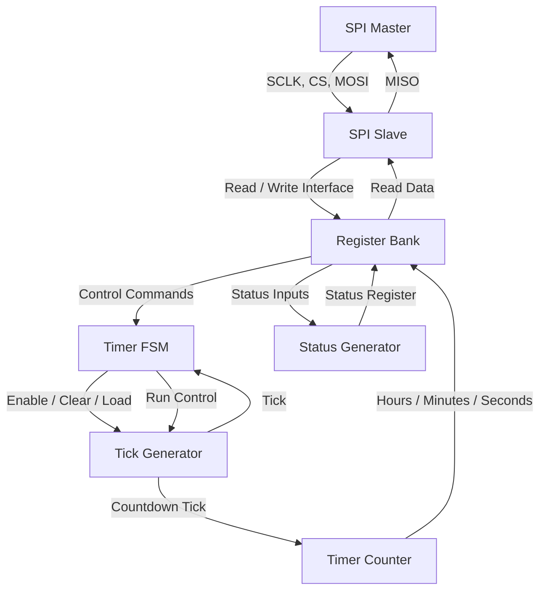
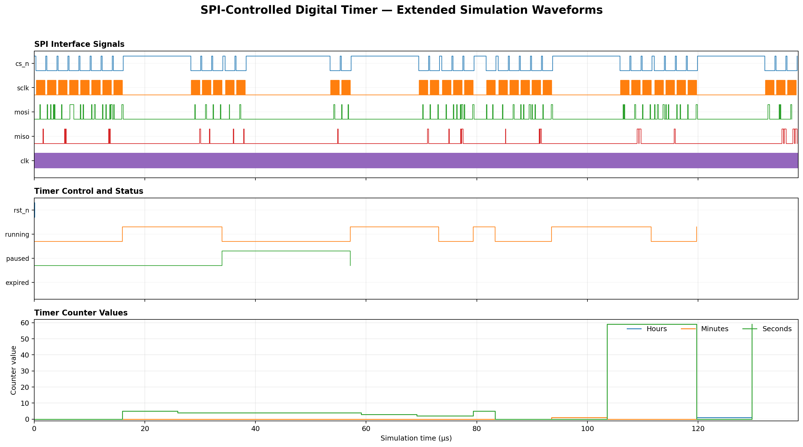

# SPI-Controlled Digital Timer Using Verilog HDL

A programmable countdown timer designed using Verilog HDL with an SPI Mode-0 slave interface. The timer supports configurable hours, minutes and seconds, along with start, stop, pause, resume and reset operations.

## 1. Features

- SPI Mode 0 communication
- 16-bit, MSB-first SPI frames
- Configurable hours, minutes and seconds
- Start, Stop, Pause, Resume and Reset commands
- Timer configuration and current-time readback through SPI
- Four timer status conditions: IDLE, RUNNING, PAUSED and EXPIRED
- Parameterized countdown tick generator
- Modular Verilog RTL design
- Basic and extended self-checking testbenches
- Simulation logs and waveform files

## 2. Project Architecture

The design is divided into six main functional blocks connected through the top-level module.



### Module Description

| RTL Module | Function |
|---|---|
| `spi_timer_top.v` | Top-level module connecting all functional blocks |
| `spi_slave.v` | Handles SPI serial communication |
| `reg_bank.v` | Stores timer configuration and control registers |
| `timer_fsm.v` | Controls timer operating states |
| `tick_gen.v` | Generates the programmable countdown tick |
| `timer_counter.v` | Maintains countdown values and time rollover |
| `status_gen.v` | Generates timer status information |

### Timer Operating States

- **IDLE:** Timer is waiting for a start command.
- **RUN:** Timer is counting down.
- **PAUSE:** Countdown is temporarily stopped.
- **EXPIRED:** Countdown has reached zero.

## 3. SPI Register Map

The timer is controlled through the following register addresses.

| Address | Register | Access |
|---|---|---|
| `0x00` | Control | Write |
| `0x01` | Status | Read |
| `0x02` | Seconds Load | Read/Write |
| `0x03` | Current Seconds | Read |
| `0x04` | Minutes Load | Read/Write |
| `0x05` | Current Minutes | Read |
| `0x06` | Hours Load | Read/Write |
| `0x07` | Current Hours | Read |

### Control Register

Register address: `0x00`

| Bit | Operation |
|---|---|
| Bit 0 | Start |
| Bit 1 | Stop |
| Bit 2 | Pause |
| Bit 3 | Resume |
| Bit 4 | Reset |

### Status Register

Register address: `0x01`

| Bit | Status |
|---|---|
| Bit 0 | Running |
| Bit 1 | Paused |
| Bit 2 | Expired |
| Bit 3 | Idle |

## 4. Project Directory Structure

```text
SPI-Controlled-Digital-Timer/
│
├── SPI_Timer/
│   ├── rtl/
│   │   ├── reg_bank.v
│   │   ├── spi_slave.v
│   │   ├── spi_timer_top.v
│   │   ├── status_gen.v
│   │   ├── tick_gen.v
│   │   ├── timer_counter.v
│   │   ├── timer_fsm.v
│   │   └── README_rtl.md
│   │
│   ├── testbench/
│   │   ├── tb_spi_timer.v
│   │   ├── tb_spi_timer_extended.v
│   │   └── tb_spi_timer_original.v
│   │
│   └── constraints/
│       └── timer.xdc
│
├── Results/
│   ├── simulation/
│   │   ├── simulation.log
│   │   └── extended_simulation.log
│   ├── synthesis/
│   └── waveforms/
│       ├── spi_timer.vcd
│       └── spi_timer_extended.vcd
│
├── scripts/
│   └── simulate.sh
│
├── .gitignore
└── README.md
```

## 5. Simulation Setup

The project uses Icarus Verilog for RTL simulation.

### Install Icarus Verilog

On Ubuntu or GitHub Codespaces:

```bash
sudo apt-get update
sudo apt-get install -y iverilog
```

Check the installation:

```bash
iverilog -V
vvp -V
```

### Run the Simulation

From the repository root:

```bash
bash scripts/simulate.sh
```

The script compiles and executes both testbenches.

## 6. Verification Results

Both testbenches completed successfully.

| Testbench | Passed | Failed |
|---|---:|---:|
| Basic testbench | 8 | 0 |
| Extended testbench | 16 | 0 |
| **Total** | **24** | **0** |

### Verification Coverage

The extended testbench checks:

- Reset and initial IDLE status
- Timer register readback
- Invalid register access
- Timer start and countdown
- Pause and counter hold
- Resume operation
- Stop operation
- Reset during operation
- Minute rollover
- Hour rollover

The testbenches use a reduced tick parameter to make countdown simulation practical.

Testbench failures and watchdog timeouts use `$fatal` to return a nonzero simulation exit code.

These results represent RTL simulation testing, not formal verification or physical FPGA testing.

## 7. Simulation Results and Waveforms

Simulation logs:

```text
Results/simulation/simulation.log
Results/simulation/extended_simulation.log
```

Waveform files:

```text
Results/waveforms/spi_timer.vcd
Results/waveforms/spi_timer_extended.vcd
```
### Extended Simulation Waveform

The following waveform visualization was generated from the actual extended testbench VCD output using a Python plotting script.



The plot includes SPI communication signals, timer control and status signals, and hours, minutes, and seconds counter values.

The VCD timescale is 1 ps, and the displayed simulation duration is 138.1 microseconds.

To regenerate the waveform image, run:

```bash
python3 scripts/plot_waveforms.py
```

The plotting script requires Python 3 and Matplotlib.

The waveform files can be opened with GTKWave:

```bash
gtkwave Results/waveforms/spi_timer_extended.vcd
```

Useful signals to inspect include:

- `clk`
- `rst_n`
- `sclk`
- `cs_n`
- `mosi`
- `miso`
- `running`
- `paused`
- `expired`
- `cur_sec`
- `cur_min`
- `cur_hr`
- `state`

## 8. FPGA Constraints

The project includes an XDC clock constraint:

```tcl
create_clock -period 10.000 -name clk [get_ports clk]
```

This specifies a 10 ns clock period (100 MHz).

The top-level timer tick parameter defaults to 100,000,000 clock cycles per second.

FPGA synthesis, implementation, timing closure and physical hardware validation have not yet been completed.

## 9. Tools Used

- Verilog HDL
- Icarus Verilog
- GTKWave (optional waveform viewer)
- Git and GitHub
- GitHub Codespaces

## 10. Author

**Maddulalokeshwar**

Project: SPI-Controlled Digital Timer Using Verilog HDL
